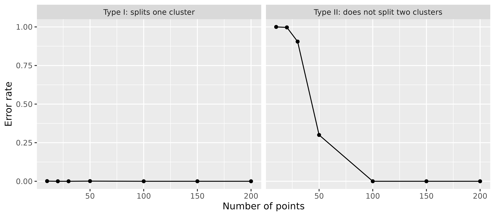

# Replicating Hamerly and Elkan (2003)

[Hamerly and Elkan
(2003)](https://proceedings.neurips.cc/paper_files/paper/2003/file/234833147b97bb6aed53a8f4f1c7a7d8-Paper.pdf)
evaluate G-means on synthetic data (their Table 1), study the
statistical power of the split test (their Figure 3), and cluster two
real datasets of handwritten digits. This article reruns these
experiments with
[`gmeans()`](https://m-muecke.github.io/gmeans/reference/gmeans.md). The
paper also compares G-means with X-means and the BIC and reports run
times, which are left out here.

The defaults of
[`gmeans()`](https://m-muecke.github.io/gmeans/reference/gmeans.md)
follow the paper: the search starts from one center (`k_init = 1`), the
Anderson-Darling test uses the significance level `level = 0.0001`, and
the number of clusters is not capped (`k_max = Inf`). The paper provides
neither its data nor its code, so the synthetic data below are
regenerated from its description, and the results can only be compared
approximately.

``` r

library(data.table)
library(ggplot2)
library(gmeans)
```

## Synthetic data

Each synthetic dataset in the paper has 5000 points in \\d = 2\\, 8, or
32 dimensions, drawn from \\k = 5\\, 20, or 80 Gaussian clusters. The
cluster means are uniform in the unit hypercube, and \\\sigma\\ is
chosen so that no two means are closer than \\3\sigma\\. Each cluster is
made non-spherical by a random scaling and rotation matrix. The paper
does not say how the scaling is drawn, so here each dimension is scaled
by a factor drawn uniformly between 0.2 and 1, which keeps every cluster
at most \\\sigma\\ wide in any direction.

``` r

simulate_clusters <- function(k, d, n = 5000L) {
  centers <- matrix(runif(k * d), nrow = k)
  sigma <- min(dist(centers)) / 3
  cluster <- rep_len(seq_len(k), n)
  x <- matrix(0, nrow = n, ncol = d)
  for (j in seq_len(k)) {
    rows <- which(cluster == j)
    rotation <- qr.Q(qr(matrix(rnorm(d * d), nrow = d)))
    shape <- diag(runif(d, 0.2, 1), nrow = d) %*% rotation
    noise <- matrix(rnorm(length(rows) * d), ncol = d)
    x[rows, ] <- sweep(sigma * noise %*% shape, 2L, centers[j, ], "+")
  }
  list(x = x, cluster = cluster)
}
```

The paper reports the number of clusters found and the distortion
relative to the distortion of the true clustering, both as mean and
standard deviation over 30 datasets per setting. Splitting the data into
more clusters than there are lowers the distortion below 1, and so does
k-means moving points near the boundary between two clusters to the
closer center. A distortion above 1 means the clusters found fit the
data worse than the true clusters.

``` r

optimal_distortion <- function(x, cluster) {
  sum(vapply(
    split(seq_len(nrow(x)), cluster),
    \(rows) sum(scale(x[rows, , drop = FALSE], scale = FALSE)^2),
    numeric(1L)
  ))
}

set.seed(2003)
settings <- CJ(d = c(2L, 8L, 32L), k = c(5L, 20L, 80L), rep = 1:30)
synthetic <- settings[,
  {
    sim <- simulate_clusters(k, d)
    fit <- gmeans(sim$x)
    .(
      k_found = nrow(fit$centers),
      distortion = fit$tot.withinss / optimal_distortion(sim$x, sim$cluster)
    )
  },
  by = .(d, k, rep)
]
```

``` r

mean_sd <- function(x, digits) {
  sprintf("%.*f ± %.*f", digits, mean(x), digits, sd(x))
}

replicated <- synthetic[,
  .(k_found = mean_sd(k_found, 1L), distortion = mean_sd(distortion, 2L)),
  by = .(d, k)
]

paper <- rowwiseDT(
  d = , k = , paper_k_found = , paper_distortion = ,
   2L ,  5L , "9.1 ± 9.9"     , "0.89 ± 0.23"      ,
   2L , 20L , "20.1 ± 0.6"    , "0.99 ± 0.01"      ,
   2L , 80L , "80.0 ± 0.2"    , "1.00 ± 0.01"      ,
   8L ,  5L , "5.0 ± 0.0"     , "1.00 ± 0.00"      ,
   8L , 20L , "20.0 ± 0.1"    , "0.99 ± 0.00"      ,
   8L , 80L , "80.2 ± 0.5"    , "0.99 ± 0.00"      ,
  32L ,  5L , "5.0 ± 0.0"     , "1.00 ± 0.00"      ,
  32L , 20L , "20.0 ± 0.0"    , "1.00 ± 0.00"      ,
  32L , 80L , "80.0 ± 0.0"    , "1.00 ± 0.00"
)

comparison <- paper[replicated, on = .(d, k)]
knitr::kable(
  comparison,
  col.names = c("d", "true k", "k found (paper)", "distortion (paper)", "k found", "distortion"),
  row.names = FALSE
)
```

|   d | true k | k found (paper) | distortion (paper) | k found     | distortion  |
|----:|-------:|:----------------|:-------------------|:------------|:------------|
|   2 |      5 | 9.1 ± 9.9       | 0.89 ± 0.23        | 11.5 ± 13.1 | 0.84 ± 0.24 |
|   2 |     20 | 20.1 ± 0.6      | 0.99 ± 0.01        | 21.0 ± 2.7  | 0.98 ± 0.04 |
|   2 |     80 | 80.0 ± 0.2      | 1.00 ± 0.01        | 80.1 ± 0.4  | 1.00 ± 0.00 |
|   8 |      5 | 5.0 ± 0.0       | 1.00 ± 0.00        | 5.1 ± 0.3   | 0.99 ± 0.01 |
|   8 |     20 | 20.0 ± 0.1      | 0.99 ± 0.00        | 20.4 ± 0.9  | 0.99 ± 0.01 |
|   8 |     80 | 80.2 ± 0.5      | 0.99 ± 0.00        | 80.7 ± 0.9  | 1.00 ± 0.00 |
|  32 |      5 | 5.0 ± 0.0       | 1.00 ± 0.00        | 5.1 ± 0.3   | 1.00 ± 0.00 |
|  32 |     20 | 20.0 ± 0.0      | 1.00 ± 0.00        | 20.3 ± 0.5  | 1.00 ± 0.00 |
|  32 |     80 | 80.0 ± 0.0      | 1.00 ± 0.00        | 81.1 ± 15.2 | 1.02 ± 0.14 |

In most settings
[`gmeans()`](https://m-muecke.github.io/gmeans/reference/gmeans.md)
finds about the true number of clusters, as in the paper. With five
clusters in two dimensions, both the paper and
[`gmeans()`](https://m-muecke.github.io/gmeans/reference/gmeans.md)
sometimes split the non-spherical clusters into many pieces.

With 80 clusters in 32 dimensions,
[`gmeans()`](https://m-muecke.github.io/gmeans/reference/gmeans.md)
usually finds a few clusters too many (median 83), while the paper finds
exactly 80. Each cluster here has only about 62 points. With so few
points in so many dimensions, the two-center k-means of the split test
can find a direction along which even a single Gaussian cluster looks
like two, so the test splits Gaussian clusters more often than the level
of 0.0001 suggests. With 80 clusters tested in every round, a few such
splits add up.

``` r

stopped_early <- synthetic[k_found < k / 2]
stopped_early
#> Key: <d, k, rep>
#>        d     k   rep k_found distortion
#>    <int> <int> <int>   <int>      <num>
#> 1:    32    80    10       2      1.781
```

In 1 of the 270 datasets,
[`gmeans()`](https://m-muecke.github.io/gmeans/reference/gmeans.md)
stops with less than half of the true clusters. This is a limitation of
G-means itself: when a split does not separate the clusters cleanly,
each part still contains many clusters, and projected onto the split
direction such a mixture can look Gaussian enough to pass the test at
the strict level of 0.0001.

## Statistical power

Figure 3 of the paper shows how often the split test makes the wrong
decision, as a function of the number of points \\n\\. A type I error
splits one Gaussian cluster, here with one axis 5% shorter than the
other. A type II error does not split two Gaussian clusters whose means
are \\5\sigma\\ apart. The paper runs 1000 tests per point.

``` r

set.seed(2003)
error_rates <- data.table(n = c(10L, 20L, 30L, 50L, 100L, 150L, 200L))
error_rates <- error_rates[,
  {
    type_1 <- replicate(1000L, {
      x <- matrix(rnorm(2L * n), ncol = 2L) %*% diag(c(1, 0.95))
      nrow(gmeans(x)$centers) > 1L
    })
    type_2 <- replicate(1000L, {
      x <- matrix(rnorm(2L * n), ncol = 2L)
      x[seq_len(n %/% 2L), 1L] <- x[seq_len(n %/% 2L), 1L] + 5
      nrow(gmeans(x)$centers) == 1L
    })
    .(
      error = c("Type I: splits one cluster", "Type II: does not split two clusters"),
      rate = c(mean(type_1), mean(type_2))
    )
  },
  by = n
]
```

``` r

ggplot(error_rates, aes(n, rate)) +
  geom_line() +
  geom_point() +
  facet_wrap(~error) +
  scale_y_continuous(limits = c(0, 1)) +
  labs(x = "Number of points", y = "Error rate")
```



As in the paper, the test almost never splits a single Gaussian cluster,
while it needs enough points to split two clusters. In the paper the
type II error is close to 1 at 10 and 20 points, about 0.37 at 50
points, and 0 from 100 points on. Here it is 0.905 at 30 points, 0.3 at
50 points, and 0 at 100 points.

## Handwritten digits

The paper clusters the Pendigits dataset from the [UCI
repository](https://archive.ics.uci.edu/dataset/81/pen+based+recognition+of+handwritten+digits),
16 features of pen trajectories of the digits 0 to 9, and reports 69
clusters with a partition quality of 0.196. The partition quality
compares the clusters \\j\\ with the true classes \\i\\: \\ \mathrm{PQ}
= \frac{\sum\_{i} \sum\_{j} p(i, j)^2}{\sum\_{i} p(i)^2}, \\ where
\\p(i, j)\\ is the share of points in class \\i\\ and cluster \\j\\, and
\\p(i)\\ is the share of points in class \\i\\. It is 1 whenever each
class lies within a single cluster, and it decreases as the classes are
split into more clusters. It does not penalize merging classes: putting
all points into one cluster also gives 1.

The paper describes the data as 7984 examples, which matches neither the
training set (7494 examples) nor the full dataset (10992 examples) on
UCI. The training set is used here, since it is the closest. The file
`pendigits-train.csv` next to this article is a copy of `pendigits.tra`,
the training set by Alpaydin and Alimoglu (1996),
[doi:10.24432/C5MG6K](https://doi.org/10.24432/C5MG6K), licensed under
[CC BY 4.0](https://creativecommons.org/licenses/by/4.0/).

``` r

pendigits <- fread(
  "pendigits-train.csv",
  header = FALSE,
  col.names = c(paste0("x", 1:16), "digit")
)
x <- as.matrix(pendigits[, !"digit"])
digit <- pendigits$digit

partition_quality <- function(truth, cluster) {
  p <- table(truth, cluster) / length(truth)
  sum(p^2) / sum(rowSums(p)^2)
}

fit <- gmeans(x)
nrow(fit$centers)
#> [1] 86
partition_quality(digit, fit$cluster)
#> [1] 0.1819
```

[`gmeans()`](https://m-muecke.github.io/gmeans/reference/gmeans.md)
finds 86 clusters with a partition quality of 0.182, compared to 69
clusters and 0.196 in the paper.

The paper also clusters 6000 randomly chosen MNIST digits after a random
projection to 50 dimensions, which is not repeated here.

## Remaining differences

Apart from the data,
[`gmeans()`](https://m-muecke.github.io/gmeans/reference/gmeans.md)
differs from the paper in these details:

- The test statistic is corrected for the sample size with the factor
  \\1 + 0.75/n + 2.25/n^2\\ from D’Agostino and Stephens (1986), while
  the paper uses \\1 + 4/n - 25/n^2\\ from Stephens (1974). The paper’s
  factor is larger for small samples, so its test splits small clusters
  more readily: to split a cluster, the uncorrected statistic has to
  exceed about 1.64 with 20 points and 1.75 with 50 points in the paper,
  but 1.77 and 1.82 here. Rerunning the power study with the paper’s
  correction lowers the type II error at 50 points by about 0.07, which
  moves it further from the paper’s figure, while the synthetic results
  barely change.
- Clusters with fewer than 8 points are not tested and therefore never
  split, since the p-value of the test requires at least 8 values.
- k-means uses the Hartigan-Wong algorithm, the default of
  [`stats::kmeans()`](https://rdrr.io/r/stats/kmeans.html). The paper
  does not say which algorithm it uses. With `algorithm = "Lloyd"`,
  [`gmeans()`](https://m-muecke.github.io/gmeans/reference/gmeans.md)
  splits fewer Gaussian clusters in high dimensions: for 80 clusters in
  32 dimensions, the median number of clusters found over 30 datasets
  drops from 83 to 81. Neither this nor the correction of the test
  statistic explains why the paper finds exactly 80 clusters.
